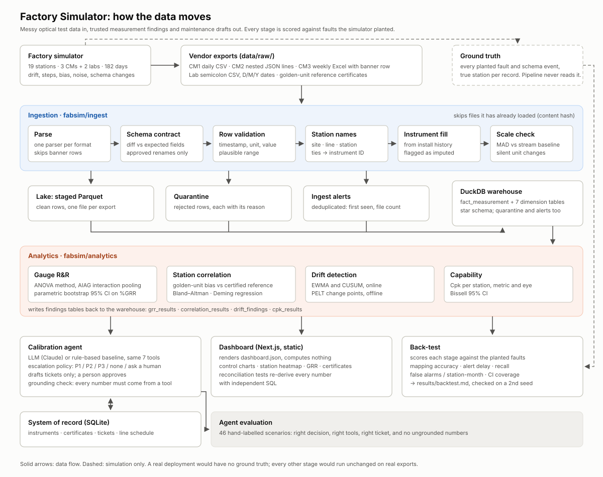

# Factory Simulator: Optical Test Data Platform

A simulated mixed-reality headset factory, and the data platform that keeps its measurements trustworthy.

Nineteen test stations at three contract manufacturers and two labs measure every headset: how sharp the image is, whether the colour is right, and whether the two eyes line up. The data is messy in the ways real factory data is messy. Stations name themselves inconsistently, some records are missing fields, vendors change their export format without warning, and instruments slowly drift out of calibration.

**Every fault is planted on purpose, and the true answer is logged.** So every stage of the platform gets a score instead of a demo: did ingestion map each station correctly, did the schema-drift alert fire on the right day, how many days did the drift detector take, did the calibration agent escalate the right instrument?



> **The data is simulated.** No real factory or vendor data is used. The simulation exists so that every result below can be checked against a known answer. See [Limitations](#limitations).

---

## Results

Two full runs, about 1.05M measurement rows each. **Seed 7** is the development seed. **Seed 11** played no part in any design choice and serves as a held-out check. All numbers are produced by `python -m fabsim backtest`; see [results/backtest.md](results/backtest.md) and [results/data_seed11/backtest.md](results/data_seed11/backtest.md).

### Ingestion

| Check | Seed 7 | Seed 11 |
|---|---|---|
| Loaded rows mapped to the wrong station | **0** of 1,042,946 | **0** of 1,043,233 |
| Rows with a non-canonical station label, mapped correctly | 749,922 / 749,922 | 748,873 / 748,873 |
| Planted schema events alerted on the day they started | **4 / 4** (0-day delay) | **4 / 4** (0-day delay) |
| Silent unit change (arcmin → degrees, same header) kept out of the warehouse | 1,948 / 1,948 rows | 1,977 / 1,977 rows |
| Rows missing a timestamp or station that leaked into the warehouse | 0 | 0 |
| Missing instrument IDs imputed correctly | 5,197 / 5,197 | 5,123 / 5,123 |
| Clean rows quarantined anyway (the cost of refusing to guess) | 0.02% | 0.01% |

### Drift detectors

20 planted drifts and steps per seed, across 76 station × metric series, 95 station-months monitored. A fault counts as detected if an alarm lands within 45 days of onset. Fault sizes range from 0.5σ to 3σ of instrument repeatability.

| Detector | Recall (seed 7 / 11) | False alarms per station-month | Median delay, days |
|---|---|---|---|
| EWMA, λ = 0.2, L = 3.5 | 20/20 · 20/20 | 0.26 · 0.14 | 8 · 10 |
| CUSUM, k = 0.5σ, h = 8σ | 19/20 · 20/20 | 0.17 · 0.11 | 11 · 10 |
| PELT change point (offline, sees the whole series) | 20/20 · 20/20 | 0.03 · 0.01 | ±5 · ±4 (localisation) |
| *For comparison: textbook EWMA L = 3* | *20/20 · 20/20* | *0.61 · 0.50* | *7 · 9* |

### Watch vs. act: which alarms become tickets

A drift alarm says a series moved more than chance would explain. It doesn't say the move is big enough to send a technician. A finding is escalated only once its trailing 7-day shift reaches **0.75 × repeatability σ**; smaller ones stay on a watch list. The threshold was chosen on seed 7 and confirmed on seed 11 ([results/escalation.md](results/escalation.md)).

| Escalation rule | Planted faults escalated (seed 7 / 11) | Median days from onset | False escalations per station-month |
|---|---|---|---|
| Every alarm (τ = 0) | 19/20 · 20/20 | 9 · 10 | 0.30 · 0.19 |
| Shift ≥ 0.5σ | 20/20 · 20/20 | 10 · 10 | 0.05 · 0.09 |
| **Shift ≥ 0.75σ (used)** | **20/20 · 20/20** | **14 · 14** | **0.00 · 0.01** |
| Shift ≥ 1.0σ | 20/20 · 18/20 | 17 · 19 | 0.00 · 0.00 |

The cost is four to five extra days before a ticket. In return, false service calls drop from roughly one every three to five station-months to one in 190 station-months across both seeds (none on seed 7, one on seed 11). A finding stays "act" once it has crossed the threshold during its current alarm, so a ticket-worthy finding can't flip back to "watch" when noise dips the latest estimate. In the final snapshot the split is exact on both seeds: every real fault with an active alarm is "act" (19 on seed 7, 20 on seed 11), and every false alarm (6 and 1) is "watch".

### Measurement-system analysis

| Check | Seed 7 | Seed 11 |
|---|---|---|
| Golden-unit bias: planted biased stations found | 4/4, 0 false flags | 4/4, 0 false flags |
| Gauge R&R: planted noisy stations rated unacceptable | 2/2 | 2/2 |
| Gauge R&R: healthy stations wrongly rated unacceptable | 0 / 74 | 1 / 74 |
| Median error of %GRR estimate | 1.7 points | 1.8 points |

Bootstrap CI coverage for %GRR, Monte Carlo over 300 fresh studies per configuration: **91–96% against a nominal 95%**. It's lowest (91%) for the metric with only 10 parts per study.

### Calibration agent

| Agent | Passed | Decision | Tools | Ticket | Grounded |
|---|---|---|---|---|---|
| Rule-based baseline | 46 / 46 | 100% | 100% | 100% | 100% |
| LLM (Claude) | *not run yet* (`python -m fabsim agent-eval --agent llm`) | | | | |

The baseline's 46/46 is a consistency check, not an achievement: I wrote both the policy and the scenarios. It shows that the tools, the policy and the scorer agree with each other. The LLM's score on the same 46 scenarios is the number that matters. Six of the scenarios test the watch/act rule, including one where the user demands a P1 for an alarm that is too small to service.

### Things the back-test caught that I would otherwise have shipped

- **Textbook control limits were too noisy.** L = 3 / h = 5 gave 0.5–0.74 false alarms per station-month. That's about one false alarm per station every two months, and with 19 stations it would train people to ignore alerts. The cause: the baseline mean and σ come from only 30 days. I picked wider limits from the operating curve on seed 7 ([results/detector_sweep.md](results/detector_sweep.md)) and confirmed them on seed 11 before adopting them.
- **A plausible fix that didn't generalise.** Removing operator effects from the golden-unit series cut false alarms on seed 7 but slightly *increased* them on seed 11 at textbook limits. It's still computed and scored, but it isn't the default.
- **Statistically real isn't the same as worth a service call.** The first dashboard showed 25 active findings, 6 of them false alarms with shifts under 0.4σ, and the agent would have drafted a ticket for each one. The watch/act threshold above fixes this without losing a planted fault.
- **A finding that flip-flopped.** The first version judged each finding only by its latest 7-day shift. A real 0.79σ step that had already crossed the line in March dipped to 0.66σ and fell back to "watch". It now stays "act" for the rest of its alarm, which also matches how the threshold was back-tested.
- **Alarm masking.** With tight limits, recall *fell*: a false-alarm episode already running when a real fault began absorbed its onset, so no new alarm fired. Wider limits fixed both problems at once.
- **A unit-change detector that cried wolf.** The first version compared median magnitude and fired on a large colour drift. It now compares spread (MAD), which a unit change rescales but a drift doesn't.
- **A vendor format without trial numbers.** CM1's export has no trial column, so every Gauge R&R repeat collapsed into trial 1. Trials are now derived from timestamp order.
- **A stale dashboard query.** The reconciliation tests failed when the dashboard switched series variant and one test didn't follow. That's the class of silent regression those tests exist to catch.

---

## What gets simulated

### Measurements (one row = one reading on one unit, eye and station)

| Metric | What it captures | Unit | Spec |
|---|---|---|---|
| `mtf50` | Sharpness: spatial frequency at which contrast falls to 50% | cycles/pixel | ≥ 0.26 |
| `lum_uniformity` | Brightness evenness across the field of view | % | ≥ 75 |
| `delta_uv` | Colour error vs. target white point (Δu′v′) | – | ≤ 0.010 |
| `vert_misalign` | Left/right vertical misalignment (binocular fusion) | arcmin | ±6 |

Each reading is `true value + station bias + operator bias + fault offset + noise`. Healthy stations are tuned to about 12 %GRR, and the planted noisy stations to about 35%.

### Sites, formats and planted schema events

| Site | Export format | Planted event |
|---|---|---|
| CM1 (5 stations) | daily long CSV, no trial column | day 60: new `fw_version` column, columns reordered |
| CM2 (5 stations) | daily nested JSON lines, UTC+8 timestamps | day 95: keys `mtf50` → `MTF_50`, `delta_uv` → `dUV` |
| CM3 (5 stations) | weekly Excel, banner row above the header | day 126: `SN` → `Serial No.` |
| LAB-SV, LAB-RD (2 benches each) | semicolon CSV, D/M/Y dates | LAB-RD day 120: `vert_misalign` silently switches to degrees |

Each site also has 10 golden units with certified reference values. They're measured daily on every station, and once in a 3-operator × 3-trial Gauge R&R study.

### Planted faults (logged to `data/ground_truth/`)

| Fault | Count per seed | What should catch it |
|---|---|---|
| Station labels in 6 spellings, e.g. `CM2-L3-ST04`, `cm2_line3_st4`, `C2L3S4`, `ST-04` | 15% of records | Station canonicaliser |
| Missing timestamp / station / instrument | 0.3% / 0.2% / 0.5% of records | Quarantine / imputation |
| Slow instrument drift, ramping 60 days then levelling off | 12 | EWMA, CUSUM, PELT |
| Step change, half caused by an instrument swap | 8 | EWMA, CUSUM, PELT |
| Fixed station bias, 1.3–3× the practical threshold | 4 | Golden-unit correlation |
| Noisy station (3.5× repeatability) | 2 | Gauge R&R |

---

## How each stage works

**Ingestion** ([fabsim/ingest](fabsim/ingest)). Each vendor has a parser and a schema contract. Every file's fields are compared to the contract. A renamed field loads only if a human has approved that rename in [config/schema_mappings.json](config/schema_mappings.json), and the first sighting raises an alert either way. Rows are validated, and station labels are parsed into site / line / station. When a label is ambiguous (`ST-01` at a site with two lines), the instrument ID settles it if possible; otherwise the row is quarantined, never guessed. Missing instrument IDs are filled from the install history and flagged. A per-stream spread check catches unit changes that range checks miss. Files are tracked by content hash, so re-runs only load new exports.

**Warehouse** ([fabsim/warehouse/build.py](fabsim/warehouse/build.py)). DuckDB over Parquet, as a star schema: `fact_measurement`, `dim_station`, `dim_station_alias`, `dim_instrument`, `dim_unit`, `dim_test_spec`, `dim_golden_reference`, plus `quarantine` and `ingest_alerts`.

**Analytics** ([fabsim/analytics](fabsim/analytics)).
- *Gauge R&R*: crossed ANOVA with AIAG interaction pooling, and a parametric-bootstrap 95% CI on %GRR. The CI's coverage is itself checked by Monte Carlo.
- *Station correlation*: bias vs. certified golden-unit values, with a t-interval over days (each day's golden run has one operator, so days are the independent unit), plus Bland–Altman and Deming regression.
- *Drift*: EWMA and CUSUM on the daily golden-unit residual, which is online and alerts as data arrives, plus PELT change points (offline, for retrospective review).
- *Capability*: Cpk with Bissell's CI.

**Calibration agent** ([fabsim/agent](fabsim/agent)). Seven tools over the system of record and the analytics findings, with one written escalation policy:

| Situation | Action |
|---|---|
| Active drift (shift ≥ 0.75σ) and certificate expired or due within 14 days | P1, service within 3 days |
| Active drift, certificate otherwise valid | P2, within 7 days |
| No drift, certificate expired | P2, within 7 days |
| No drift, certificate due within 30 days | P3, before expiry |
| Ticket already open for the instrument | Don't duplicate |
| No service window before the deadline | Hand to a human |
| Drift alarm below 0.75σ ("watch") | Report it, but no ticket on its own |

The agent only *drafts* tickets. Every answer passes a grounding check: each number, date and time in it must appear in a tool result, or the answer is flagged. The LLM version uses the Anthropic SDK (`claude-opus-5-5`) and has a deterministic rule-based twin for comparison.

**Dashboard** ([dashboard](dashboard)). A static Next.js / TypeScript app that renders one JSON file and computes nothing. It shows control charts with alarm episodes (and, optionally, the planted fault), a station-difference heatmap, Gauge R&R intervals, certificates due, and ingestion health. [tests/test_reconciliation.py](tests/test_reconciliation.py) re-derives its numbers with independent SQL.

---

## Quickstart

```bash
python3 -m venv .venv && .venv/bin/pip install -r requirements.txt
.venv/bin/python -m fabsim all            # simulate → ingest → analyze → backtest → dashboard JSON (~2 min)
.venv/bin/python -m pytest -q             # 40 tests, including dashboard reconciliation
.venv/bin/python -m fabsim agent-eval     # rule-based agent on the 46 scenarios

# The LLM agent needs an Anthropic API key and bills your account (46 scenarios, several calls each):
ANTHROPIC_API_KEY=... .venv/bin/python -m fabsim agent-eval --agent llm
.venv/bin/python -m fabsim agent "Drift alarm on cm2_line3_st2, what should we do?"

cd dashboard && npm install && npm run dev   # http://localhost:3000

# A held-out seed, side by side with the first:
FABSIM_DATA=data_seed11 .venv/bin/python -m fabsim all --seed 11 --no-monte-carlo
```

## Repository layout

```
fabsim/sim/          stations, measurement model, fault planting, vendor export writers, system of record
fabsim/ingest/       parsers, schema contracts + drift detector, station resolver, ingestion pipeline
fabsim/warehouse/    DuckDB star schema build
fabsim/analytics/    gauge_rr, correlation, drift, cpk, run (writes findings tables)
fabsim/backtest/     scoring against ground truth; detector operating curve; watch/act escalation curve
fabsim/agent/        world, tools + policy, LLM runtime, rule baseline, grounding check, 46 scenarios, eval
dashboard/           Next.js app (reads public/dashboard.json)
config/              approved schema renames
docs/                architecture diagram
results/             back-test, sweep and agent-eval outputs (committed)
tests/               unit tests and dashboard reconciliation
```

## Not done yet

- [ ] Run the LLM agent evaluation and report it next to the baseline
- [ ] Run the analytics on a real public dataset ([Bosch Production Line Performance](https://www.kaggle.com/c/bosch-production-line-performance) or [UCI SECOM](https://archive.ics.uci.edu/dataset/179/secom))
- [ ] Derive MTF50 from synthetic slanted-edge images (ISO 12233) instead of sampling it
- [ ] Wrap the CLI stages in an orchestrator (Dagster or Prefect) with a schedule
- [ ] Back-test over more seeds, to put intervals on recall and the false-alarm rate

## Limitations

- **The factory is simulated.** Noise levels, fault sizes and fault rates are my own modelling choices, informed by public measurement-systems-analysis practice, not by any real factory's data.
- **Doing well on planted faults is necessary, not sufficient.** Real faults can be shaped differently from the ones I chose to plant, and a fault model I didn't think of won't appear in these numbers.
- **Two seeds is a small sample.** The detector limits and the watch/act threshold were each chosen on one seed and confirmed on one more. More seeds would put error bars on the false-alarm rate.
- **The grounding check exempts integers 0–9** (counts like "two findings"), so a fabricated single-digit value would pass.
- **Scale.** The default run is about 1.05M rows and takes about 2 minutes end to end on a laptop. A `--scale 10` run (8.2M rows, 463 MB of raw exports) took 41 minutes end to end on the same laptop. Ingestion results held: 0 wrong station mappings out of 8.16M rows, and the unit change fully quarantined. Most of the time goes to row-by-row export writing and parsing, which is single-threaded. I haven't tested anything beyond that, so I make no claim about 50–100M rows. Drift detection runs on golden units, whose volume doesn't grow with `--scale`, so detector results at 10× are about the same as at 1×.
